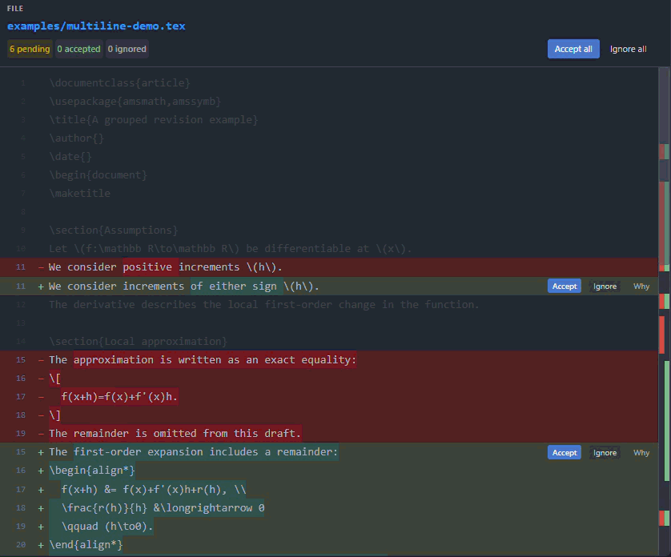

# Revision Request

**Revision Request** is a VS Code extension that lets you review proposed changes and decide which ones to apply to your files.

Each `.rr` file contains a revision request for one existing UTF-8 text file (for example, `.py`, `.ts`, `.md`, `.json`, and `.tex`). Opening it does not modify the original.

**Accept** applies the change, **Ignore** leaves the original unchanged.

<!-- demo:start -->

<!-- demo:end -->

## Installation 

- Search for `revision request` in the Extensions view in VS Code.
- Download via [marketplace](https://marketplace.visualstudio.com/items?itemName=kyjung2357.revision-request).

## Review a revision request

1. Open the project folder containing the original file in VS Code, and place the `.rr` request inside that workspace.
2. Open the `.rr` file. Its preview opens automatically by default; if needed, right-click the request in Explorer and choose **Open Preview**.
3. Compare the original and proposed text, then use **Accept** or **Ignore** for each change.
4. When finished, keep the `.rr` file to retain available Undo controls, or delete it. By default, **Accept all** and **Ignore all** ask whether to delete the request when they complete the review.

Try the [example requests](examples/README.md) for replacements, added and deleted lines, an empty starting file, and clearing all content.

Accepting changes requires workspace trust. Unsaved or conflicting changes to the original block Accept and Undo of accepted changes. If the original has changed outside this review, generate a fresh request from the current file.

### Buttons

- **Accept**: Apply and save the selected change to the original file.
- **Ignore**: Record the decision without changing the original.
- **Accept all / Ignore all**: Decide all remaining pending changes in the request.
- **Undo**: Return an accepted or ignored change to pending. Undoing Accept restores that change's original text while preserving other accepted changes. Undo remains available while the `.rr` exists and the original still matches the recorded changes.
- **Why**: Show the change's explanation in a popover. Without an explanation, the button stays disabled and its text blends into the background.
- **ORIGINAL**: Click the filename beneath this label to open the editable original file.
- **Toggle Comparison Layout**: Use the preview title-bar button to switch between side-by-side columns and a unified view with removed text followed by added text. Unified is the default; choose another default in Settings. The preview remembers your choice.
- **Native diff**: Use this Explorer context-menu command on a `.rr` file to open VS Code's built-in comparison.
- **Open RR as JSON**: Use this Explorer context-menu command to inspect the stored request without automatically opening its preview.

## Create a request with an AI agent

Ask your AI agent to create a `.rr` request without modifying the original. The [request format](docs/FORMAT.md) explains the JSON structure and includes examples for replacements, insertions, and deletions.

MCP lets the agent read the original, create requests, open previews, and check your review decisions through the extension. Open and trust your local workspace in VS Code with Revision Request enabled, then ask your agent:

> Read the [Revision Request MCP guide](https://github.com/kyjung2357/revision-request/blob/main/docs/MCP.md) and help me connect this AI client to Revision Request. Use the configuration generated by the VS Code extension, and verify access to my workspace after connecting.

The agent may need you to run **Revision Request: Copy MCP Configuration** or reconnect your AI client. **Agent Accept, Ignore, and Undo through MCP are disabled by default.** See the [MCP guide](docs/MCP.md) for setup and tool details. MCP is optional when an agent writes a `.rr` file directly.

For the desktop plugin with bundled skills and an MCP launcher, see [plugin setup](plugin/README.md). If tools are missing or instructions seem outdated, run **Revision Request: Diagnose MCP Connection**; see [connection diagnostics](docs/MCP.md#diagnose-a-connection).

## Create a request from your own edits

Use this workflow when you have edited a copy yourself and want someone else to review the changes.

1. Keep the original file, such as `paper/section.tex`, and make your edits in a separate copy, such as `paper/section.proposed.tex`.
2. Open and trust the workspace containing the original in VS Code. Save both files.
3. Run **Revision Request: Create Revision Request** from the Command Palette. The creation window explains the workflow and the two file roles.
4. Use **Select original** and **Select modified copy**, check the selected paths, then click **Create Revision Request**. The extension creates `paper/section.tex.rr` beside the original and opens its preview. Both input files remain unchanged, and an existing request is never overwritten.
5. Send the generated `.rr` file, with its changes still pending, to the reviewer.

The reviewer needs Revision Request and a copy of the original with the same contents at the request's workspace-relative `path`. If they already have that original, you only need to send the `.rr` file. An agent can also compare two saved workspace files through [`rr_create_request_from_files`](docs/MCP.md#create-a-request-from-two-saved-files).

### Using the repository CLI

From a clone of this repository, run `npm ci` once, then:

```sh
npm run request -- --workspace . --original paper/section.tex --proposed paper/section.proposed.tex --reason "Clarify the definition."
```

This creates `paper/section.tex.rr` without changing either input. Optional `--output proposals/section.tex.rr` selects another existing folder inside the workspace; keep the filename `section.tex.rr`. Existing requests are never overwritten. Run `npm run request -- --help` for all options.

Both creation methods preserve the original line endings and UTF-8 BOM. Changes that line entries cannot represent, such as line-ending-only or final-newline-only changes, are rejected.

## Other functions 

- **Navigate changes**: The 15px scrollbar shows red/green markers for pending changes. Click a marker to jump to it, or drag the thumb to scroll. It sits between the columns in side-by-side view and at the right edge in unified view. Accept and Undo preserve your place.

- **Resize columns**: Drag the narrow line immediately left of the center scrollbar; the preview remembers its position. Both code areas keep the same wrapping width. Double-click to restore equal widths. With the divider focused, use Left/Right arrows, Shift for larger steps, or Home/End for the width limits.

- **Edit proposal**: Click pending code to edit it directly in place. Alt+click adds cursors within that block for simultaneous typing, deletion, and pasting. **Accept** applies the current edited text immediately; no separate Save step is needed. Ctrl+Enter (also Cmd+Enter on macOS) does the same; change or disable it with `revisionRequest.acceptShortcut`. **Ignore** discards the draft and ignores the proposal. Escape cancels the draft; with multiple cursors, the first Escape returns to one cursor. Accepting text restored to the original removes that entry without changing the original. Undo resolved entries before editing them.


## Settings

See [Settings](docs/SETTINGS.md) for preview behavior, appearance, completed-request cleanup, and MCP permissions, with their defaults.

## Limits

Requests are limited to 20 MiB, source text and each fragment to 5 MiB of UTF-8 text, and each reason to 50,000 UTF-8 bytes. Up to 10,000 entries are allowed, subject to bounded comparison time. NUL characters, invalid Unicode, binary files, non-UTF-8 files, absolute paths, traversal, and unsafe filenames are rejected.

See the [JSON schema](schemas/revision-request.schema.json) and [MCP connection guide](docs/MCP.md).

## Develop

```sh
npm ci
npm run check
npm run build
npm test
```

Press **F5** to launch an Extension Development Host. Test Accept against disposable files.

Additional checks: `npm run test:extension`, `npm run test:mcp`, and `npm run test:ui` (Edge or Chrome required).

Run `npm run package` to create a VSIX; its path is printed. Install it with **Extensions → Install from VSIX...**.

Run `npm run test:plugin` for the plugin connection checks and `npm run package:plugin` to create its ZIP package. The repo marketplace in `.agents/plugins/marketplace.json` also supports local installation directly from `plugin/`.

Tested on **Windows with VS Code 1.145.3**. macOS, Linux, and VS Code 1.96 remain untested.

## License

Revision Request is released under the [MIT License](LICENSE), which permits commercial reuse with its required notices. Bundled third-party components retain their respective licenses. Their copyright and license notices are included in `THIRD_PARTY_NOTICES.txt` with the extension. Keep those notices when redistributing the extension.